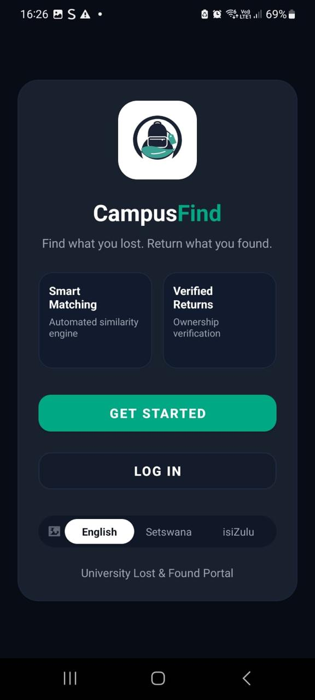
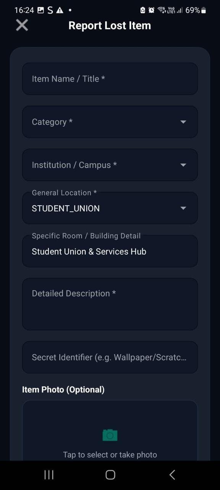
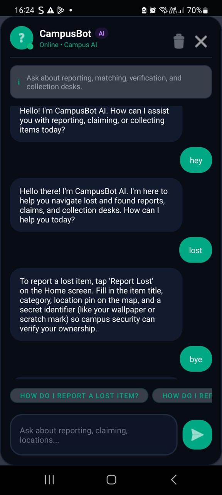
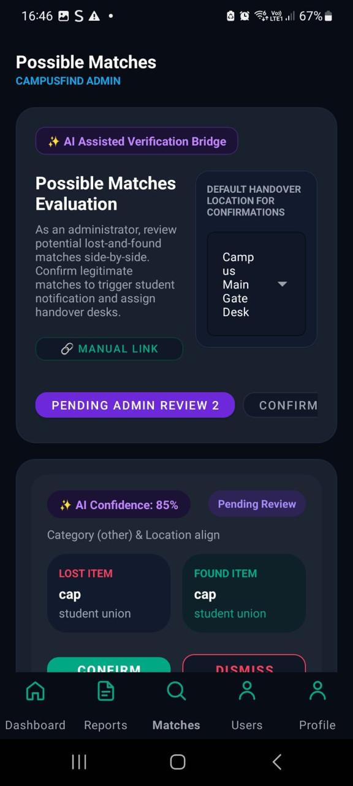

## Google Play Store Listing

  

<h2 align="center">CampusFind</h2>

  Find it. Report it. Reunite it.

  <b>Education</b> | Android Application

---

### About this app

**Find your lost belongings. Help others find theirs.**

CampusFind is a mobile lost-and-found application designed to make it easier for students to report, search for, and recover lost belongings within their campus environment.

Losing personal belongings on campus can be frustrating. CampusFind provides a centralised platform where students can report lost items, submit found-item reports, and search for belongings reported by other users.

With intelligent features and a user-friendly interface, CampusFind aims to simplify the process of connecting lost items with their rightful owners.

### What you can do with CampusFind

**REPORT LOST AND FOUND ITEMS**

- Submit reports for lost belongings.
- Report items found within the campus environment.
- Upload pictures to help identify reported items.
- View information about submitted reports.

**SEARCH AND MATCH ITEMS**

- Search for reported items.
- Use voice search to find items more conveniently.
- Benefit from AI-powered matching to identify potential matches between lost and found reports.

**AI-POWERED ASSISTANCE**

- Interact with the AI chatbot for assistance.
- Receive guidance when using the application.
- Use intelligent matching functionality to assist with the item recovery process.

**MANAGE YOUR ACCOUNT**

- Register and log in using email and password.
- Sign in using Google Single Sign-On.
- Edit personal profile information.
- Manage application preferences.
- Switch between light and dark mode.

**ITEM RECOVERY AND NOTIFICATIONS**

- Support ownership verification.
- Track the return of recovered items.
- Receive notifications through Firebase Cloud Messaging.

**MULTI-LANGUAGE SUPPORT**

CampusFind supports:
- English
- Setswana
- isiZulu

The language options help make the application accessible to students from different language backgrounds.

---

### App Screenshots

  
  
  

  
  
  

---

### App Support

For application-related assistance, please refer to the project repository:

[CampusFind – GitHub Repository](https://github.com/ST10448358/CampusFind.git)

---

### Privacy and Data

CampusFind uses Firebase services to support application functionality, including authentication and cloud data storage.

Further information about the application's data collection, storage, and privacy practices should be provided in its privacy policy before public distribution.

---

**Publication Status:** Not published on Google Play. This section represents the proposed Google Play Store listing for the CampusFind application.
